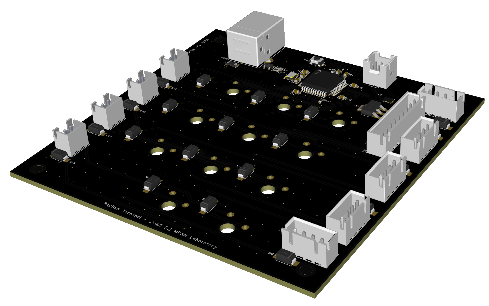

# Hardware Technical Specification

**Rhythm Terminal Lite — Main Controller Board (`rt-251014`)**

*Document version: v1.1 | Last updated: 2025-10-15 (capacitor note 2026-03-15)*



This document describes the electrical design of the Rhythm Terminal Lite main board: an
**ATmega32U4 (5 V logic)** MCU driving an **NXP PN5180 NFC frontend (3.3 V logic)** over SPI,
together with a **4×5 anti-ghosting matrix keypad** and **reactive LED indicators**.

---

## 1. Overview

- **MCU**: ATmega32U4 (16 MHz, 5 V logic), USB HID + USB CDC.
- **NFC frontend**: NXP PN5180 module (3.3 V logic, 5 V RF power amplifier supply).
- **Level translation**: TI `SN74AXC4T245RSVR` dual-supply 4-bit translator for the
  5 V ↔ 3.3 V SPI/control interface.
- **Power**: single 5 V input rail; 3.3 V generated by an `AMS1117-3.3` LDO.
- **Input**: 4×5 matrix keypad with one `SOD-4002-SH` diode per key (anti-ghosting) and 5
  dedicated LEDs for the first row.

```
                    +-------------------------------+
                    |        USB 5 V (VBUS)         |
                    +-------------------------------+
                          |                |
                          v                v
               +------------------+   +------------------+
               |  AMS1117-3.3 LDO |   |   ATmega32U4     |
               +------------------+   |   (16 MHz, 5 V)  |
                          |           +------------------+
                          v                |     |     |
                 +----------------+        |     |     |
                 |  3.3 V rail    |        |     |     |
                 +----------------+        |     |     |
                    |            |         |     |     |
                    v            |         |     |     |
           +------------------+   |  5V SPI & ctrl  |  (PB4-PB7, PD6)
           |  SN74AXC4T245    |<--+         |        |   LED drive
           |  level shifter   |             |        |
           +------------------+             |        |
                    | 3.3 V SPI             |        |
                    v                       v        v
           +------------------+   +------------------+
           |  NXP PN5180 NFC  |   | 4×5 diode matrix |
           | (SPI + 5V RF amp)|   |   keypad & LEDs  |
           +------------------+   +------------------+
```

---

## 2. Power Supply & Distribution

| Rail  | Voltage | Source             | Consumers & Function                                             |
| :---- | :------ | :----------------- | :--------------------------------------------------------------- |
| **+5V**   | 5.0 V   | Main input / VBUS  | ATmega32U4 MCU, PN5180 RF antenna amplifier (`5V` pin), keypad LED anodes |
| **+3.3V** | 3.3 V   | AMS1117-3.3 output | PN5180 logic supply (`3.3V` pin), `SN74AXC4T245` low side (`VCCB`) |
| **GND**   | 0 V     | Common ground      | Unified system ground plane                                      |

### Critical notes

1. **PN5180 dual rails**
   - The PN5180 `5V` pin powers the on-module **RF power amplifier** (max field strength /
     read range).
   - The PN5180 `3.3V` pin is the **digital logic supply** and **must** be fed from the
     regulated AMS1117-3.3 output.
   - Do **not** tie the AMS1117-3.3 output in parallel with any on-module LDO output (if the
     breakout has its own regulator).
2. **Decoupling capacitors** (added 2026-03-15, hand-soldered onto production boards)
   - Per the SN74AXC4T245 datasheet, a **0.1 µF (100 nF)** ceramic capacitor is required
     close to each of `VCCA` (+5 V) and `VCCB` (+3.3 V). These were retrofitted on the
     assembled PCB.

---

## 3. Logic Level Translation (`SN74AXC4T245`)

The `SN74AXC4T245RSVR` is configured as a **unidirectional 5 V → 3.3 V** driver for the
high-speed master signals (MOSI, SCK, NSS, RST):

| Pin       | Connection | Meaning                                        |
| :-------- | :--------- | :--------------------------------------------- |
| `VCCA`    | +5 V       | High-voltage side (MCU interface)              |
| `VCCB`    | +3.3 V     | Low-voltage side (PN5180 interface)            |
| `1DIR/2DIR` | +5 V     | Fixed direction **A → B** (MCU → PN5180)       |
| `1OE#/2OE#` | GND      | Active-low, permanently enabled                |

### Return lines (PN5180 → MCU), no translation needed

- **MISO (PB3)**: the PN5180 drives MISO at 3.3 V. With `VCC = 5 V` the ATmega32U4 high
  input threshold is `V_IH(min) = 0.2·VCC + 0.9 V ≈ 1.9 V`, so a 3.3 V high level is read
  reliably — **connect directly, no level shifter**.
- **BUSY (PF1)**: driven at 3.3 V by the PN5180, connected directly to the MCU input.

---

## 4. Pinout & Signal Mapping

> The firmware pin assignments are defined in [`firmware/Config.h`](../firmware/Config.h).
> Keep the two in sync.

### 4.1 ATmega32U4 ↔ PN5180 NFC module

| Signal  | ATmega32U4 Pin | Arduino Pin | Level shifter path        | PN5180 Pin | Function                   |
| :------ | :------------- | :---------- | :------------------------ | :--------- | :------------------------- |
| MOSI    | PB2            | D16 (ICSP-4)| 74AXC `1A1 → 1B1`         | MOSI       | SPI master out / slave in  |
| SCK     | PB1            | D15 (ICSP-3)| 74AXC `1A2 → 1B2`         | SCK        | SPI clock                  |
| NSS (CS)| PF0            | D23 (A5)    | 74AXC `2A1 → 2B1`         | NSS        | SPI slave select (low)     |
| RST     | PF4            | D21 (A3)    | 74AXC `2A2 → 2B2`         | RST        | Module reset (low)         |
| MISO    | PB3            | D14 (ICSP-1)| *direct*                  | MISO       | SPI master in / slave out  |
| BUSY    | PF1            | D22 (A4)    | *direct*                  | BUSY       | Transceiver busy flag      |
| +5 V    | VCC            | 5 V         | —                         | 5V         | RF power amplifier supply  |
| +3.3 V  | —              | 3.3 V       | —                         | 3.3V       | Digital logic supply       |
| GND     | GND            | GND         | —                         | GND        | Common ground              |

### 4.2 `SN74AXC4T245` channel assignment

| Channel | High side (5 V) | Low side (3.3 V) | Signal |
| :------ | :-------------- | :--------------- | :----- |
| 1A1/1B1 | MOSI_HV         | MOSI_LV          | MOSI   |
| 1A2/1B2 | SCK_HV          | SCK_LV           | SCK    |
| 2A1/2B1 | NSS_HV          | NSS_LV           | NSS    |
| 2A2/2B2 | RST_HV          | RST_LV           | RST    |

### 4.3 ICSP header (2×3, not assembled by default)

| Pin | Signal   | Description                  |
| :-: | :------- | :--------------------------- |
| 1   | MISO     | SPI slave output (PB3)       |
| 2   | +5 V     | Power                        |
| 3   | SCK_HV   | SPI clock, 5 V side (PB1)    |
| 4   | MOSI_HV  | SPI master out, 5 V side (PB2) |
| 5   | RESET    | System reset                 |
| 6   | GND      | Ground                       |

---

## 5. 4×5 Matrix Keypad Subsystem

A **4-row × 5-column (20-key)** matrix scanned directly by the ATmega32U4 — no external
matrix controller.

### 5.1 Matrix pin assignments

| Row / Column | ATmega32U4 Pin | Arduino Pin | Default state               |
| :----------- | :------------- | :---------- | :-------------------------- |
| ROW 1        | PC6            | D5          | OUTPUT, HIGH (pulled LOW to scan) |
| ROW 2        | PD7            | D6          | OUTPUT, HIGH (pulled LOW to scan) |
| ROW 3        | PD4            | D4          | OUTPUT, HIGH (pulled LOW to scan) |
| ROW 4        | PD3            | D1          | OUTPUT, HIGH (pulled LOW to scan) |
| COL 1        | PF5            | D20 (A2)    | INPUT_PULLUP (active LOW)   |
| COL 2        | PF6            | D19 (A1)    | INPUT_PULLUP (active LOW)   |
| COL 3        | PF7            | D18 (A0)    | INPUT_PULLUP (active LOW)   |
| COL 4        | PE6            | D7          | INPUT_PULLUP (active LOW)   |
| COL 5        | PC7            | D13         | INPUT_PULLUP (active LOW)   |

`PE2` is reserved for **HWB / USB Boot Enable** and is not part of the matrix.

### 5.2 Anti-ghosting diodes

- **Diode**: `SOD-4002-SH` (or SMD equivalent `1N4148W` / `1N4148WS`).
- **Orientation**: **anode → COLUMN (COL), cathode → ROW (ROW)**.
- **Quantity**: 20 (one per switch).
- **Purpose**: when multiple keys are pressed, the diodes block reverse sneak paths between
  inactive and active rows, eliminating ghost/phantom keys.

```
   COL line (INPUT_PULLUP)
        |
        +------+
               |
          [ Switch ]
               |
              ---   Diode (SOD-4002-SH)
              \ /   cathode towards ROW
              ---
               |
        +------+
        |
   ROW line (driven LOW during active scan)
```

---

## 6. Physical Connectors & Wiring (XH2.54)

### 6.1 ROW 1 — 5× XH2.54-4P (illuminated arcade keys)

Row 1 carries five illuminated buttons (keys 1–5). Each key uses an XH2.54-4P header:

| Pin | Signal        | Description                                        |
| :-: | :------------ | :------------------------------------------------- |
| 1   | +5 V          | LED anode supply                                   |
| 2   | Lx (L1–L5)    | LED cathode return (sinks to PB4–PB7, PD6)         |
| 3   | COL (1–5)     | Keypad column line (switch terminal)               |
| 4   | ROW 1         | Common row line (PC6 / D5)                         |

### 6.2 ROW 2, ROW 3, ROW 4 COL 1 — mechanical switches (11 keys)

Mechanical key switches (Cherry MX / Kailh style) via 2-pin or 4-pin XH2.54 headers:

| Pin | Signal | Description                     |
| :-: | :----- | :------------------------------ |
| 1   | Diode cathode → COL | Column line (switch terminal) |
| 2   | ROW    | `PD7` (ROW 2), `PD4` (ROW 3), `PD3` (ROW 4) |

### 6.3 ROW 4 COL 2–5 — 4× XH2.54-2P (auxiliary/navigation keys)

Four individual 2-pin headers for auxiliary/navigation keys (e.g. Test, Service, Coin, Menu):

| Pin | Signal | Description              |
| :-: | :----- | :----------------------- |
| 1   | Diode cathode → COL | Column line (switch terminal) |
| 2   | ROW    | Common ROW 4 (`PD3` / D1) |

---

## 7. Reactive LED Indication Subsystem

| Channel | MCU Pin | Arduino Pin | Controlled button  | Recommended resistor |
| :------ | :------ | :---------- | :----------------- | :------------------- |
| L1      | PB4     | D8          | Row 1, Column 1    | 2.2 kΩ               |
| L2      | PB5     | D9          | Row 1, Column 2    | 2.2 kΩ               |
| L3      | PB6     | D10         | Row 1, Column 3    | 2.2 kΩ               |
| L4      | PB7     | D11         | Row 1, Column 4    | 2.2 kΩ               |
| L5      | PD6     | D12         | Row 1, Column 5    | 2.2 kΩ               |

- **Common anode**: all LED anodes connect to +5 V.
- **Low-side drive (active LOW)**: MCU `LOW` turns the LED on; `HIGH` turns it off.
- With 2.2 kΩ resistors the current is ≈ 2 mA per channel (bright, low thermal load, low
  total USB current draw).

---

## 8. Keypad Scan Logic (firmware reference)

Recommended software implementation (see `firmware/PN5180-cardio.ino`):

1. **Init**
   - Rows: outputs, all high (or high-Z).
   - Columns: inputs with pull-up.
2. **Scan**
   - Pull one row `LOW`, keep the others `HIGH`.
   - Wait ~1 ms, read the column inputs.
   - Record the pressed state, then restore the row.
   - Full scan period: 10–20 ms.
3. **Debounce**
   - Treat a state as stable only after it is observed continuously for ≥ 10 ms.
4. **Mapping**
   - Encode each key as `row * 5 + col` for a clean software key index.

---

## 9. Hardware Files in this Repository

| Path / File | Description | Format |
| :---------- | :---------- | :----- |
| [`3D_PCB1_2026-09-25.png`](./3D_PCB1_2026-09-25.png) | 3D render of the assembled PCB | PNG |
| [`Gerber_PCB1_2026-09-25.zip`](./Gerber_PCB1_2026-09-25.zip) | Production Gerber & drill files | RS-274X (JLCPCB / PCBWay ready) |
| [`SCH_Schematic1_2026-09-25.pdf`](./SCH_Schematic1_2026-09-25.pdf) | Full electrical schematic | PDF |
| [`rt-251014.eprj2`](./rt-251014.eprj2) | Editable schematic & PCB source project | EasyEDA Pro (嘉立创 EDA 专业版) |
| [`3d-model/printable-model.3mf`](./3d-model/printable-model.3mf) | Complete 3D-printable enclosure package | 3MF |
| [`3d-model/pcb-holder.*`](./3d-model/) | Main controller PCB mounting bracket | STL / SketchUp |
| [`3d-model/reader-holder.*`](./3d-model/) | PN5180 NFC antenna mounting cradle | STL / SketchUp |
| [`3d-model/stand-left.*`](./3d-model/) | Left desktop angled stand bracket | STL / SketchUp |
| [`3d-model/stand-right.*`](./3d-model/) | Right desktop angled stand bracket | STL / SketchUp |

## 10. Enclosure & Front Plate

The front plate is reused directly from the original
[RhythmTerminal-OSS `front-plate-cutout.dxf`](https://github.com/MPAMlab/RhythmTerminal-OSS/blob/main/model/front-plate-cutout.dxf).
It uses a **sandwich structure**:

- two laser-cut acrylic panels (front and back), and
- one **A3+** printed (and trimmed) paper artwork sheet sandwiched between them.

> **Note**: The A3+ printed artwork sheet is **not published** in this repository.
